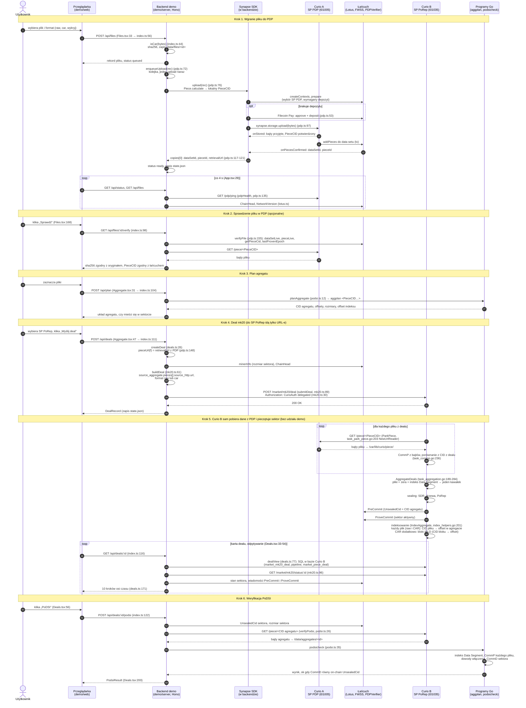

# Demo PDP → PoDSI → PoRep: diagram sekwencji

Diagram powstał na podstawie kodu w `demo/` (backend `demo/server/*.ts`, frontend `demo/web/src/*.tsx`) oraz Curio v1.29.0.
Przy strzałkach podano `plik:linia`.

Powiązane: [DEMO-JAK-DZIALA.md](DEMO-JAK-DZIALA.md) · [DEMO-PRZEPLYW-DANYCH.md](DEMO-PRZEPLYW-DANYCH.md) · [DEMO-KOD.md](DEMO-KOD.md)



## Jak czytać

- **Bajty plików idą tylko dwoma drogami:**
  - przeglądarka → backend → Synapse → Curio A (krok 1);
  - Curio A → Curio B (krok 5, ParkPiece).
  Do Curio B demo wysyła wyłącznie JSON z CID-ami i adresami URL (krok 4).
- **Krok 5 dzieje się bez udziału demo.** Demo tylko obserwuje postęp: odpytuje bazę Curio B, `/market/mk20/status` i łańcuch.
- **Krok 6 robi to, co mógłby zrobić każdy z zewnątrz.** Pobiera agregat publicznym `/piece/`, a potem porównuje go z łańcuchem.

## Podgląd

- GitHub, GitLab i VS Code (z rozszerzeniem Markdown Preview Mermaid Support) renderują diagram bezpośrednio.
- Gotowy obraz: [DEMO-SEKWENCJA.png](DEMO-SEKWENCJA.png).
- Można też wkleić blok ` ```mermaid ` na https://mermaid.live.
